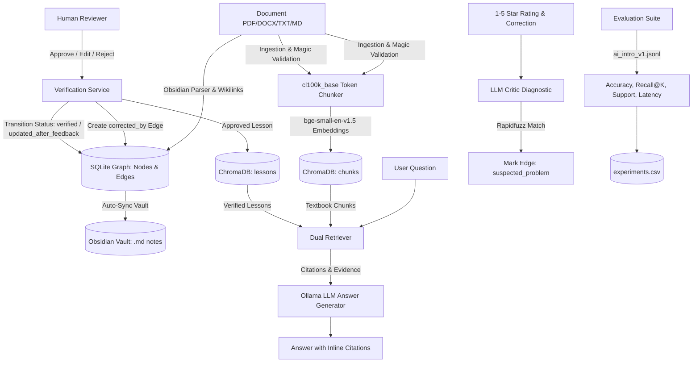

# Graph-Based Self-Learning RAG Agent (RAG-Graph)

A production-grade, graph-augmented retrieval system that learns continuously from negative human feedback and reviewer verification. Traditional RAG systems are static—they repeat identical mistakes unless documents are re-indexed. **RAG-Graph** solves this by routing negative user feedback into an LLM Critic diagnostic pipeline, mapping errors onto a knowledge graph, undergoing human-in-the-loop verification, and persisting verified corrections directly into active vector memory.

---

## Architecture Overview



---

## Key Features

1. **Multi-Format Document Ingestion**
   - Validates MIME and magic bytes (`application/pdf`, `docx`, `text/plain`, `text/markdown`).
   - Parses text while preserving headings and structure using PyMuPDF, python-docx, and markdown-it.
   - Chunks text into 400-token blocks with 50-token overlap using `tiktoken`.

2. **Dual-Collection Vector Retrieval**
   - Embeds query and context with `BAAI/bge-small-en-v1.5` via `sentence-transformers`.
   - Simultaneously queries both `chunks` (document evidence) and `lessons` (verified corrections).
   - Only lessons with status `verified` are injected into generation context, preventing feedback poisoning.

3. **Critic Failure Analysis & State Machine**
   - Collects 1–5 star ratings and natural language user corrections.
   - When rating < 3 or a correction is submitted, the LLM Critic analyzes failure mode (`fact_conflict`, `retrieval_miss`, `hallucination`, `ambiguity`, `overgeneralization`).
   - Fuzzy-matches concepts against SQLite knowledge graph nodes using `rapidfuzz` and marks target edges as `suspected_problem` (red).

4. **Human Review & Promotion Pipeline**
   - **Approve**: Promotes candidate lesson to `verified` (green), updates the target edge to `updated_after_feedback` (blue), inserts a `corrected_by` edge, and adds the lesson embedding to ChromaDB.
   - **Edit & Approve**: Modifies lesson text before promotion.
   - **Reject**: Reverts the suspect edge back to its previous baseline status (`unevaluated` or `verified`).

5. **Obsidian 3D Rotatable Dynamic Knowledge Graph**
   - Fully interactive 3D WebGL force-directed graph built with `3d-force-graph` and Three.js.
   - **Orbit & Rotation**: Left-click + drag to freely rotate around all 3 axes in real-time space.
   - **Dynamic Orbit Mode**: Toggle smooth 360° auto-rotation around the 3D graph.
   - **Obsidian Vault Sync**: Automatically writes clean Markdown notes with `[[wikilinks]]` and `.obsidian` configurations to `data/runtime/obsidian_vault/`, allowing direct opening in the Obsidian desktop application!
   - Status indicators:
     - ⚪ **Unevaluated** (`#94a3b8`): Unchecked graph baseline.
     - 🔴 **Suspected Problem** (`#ef4444`): Critic flagged a contradiction/miss.
     - 🟡 **Pending Correction** (`#f59e0b`): Candidate lesson awaiting review.
     - 🟢 **Verified** (`#10b981`): Approved lesson node / valid fact.
     - 🔵 **Updated After Feedback** (`#3b82f6`): Edge corrected by human verification.

6. **Continuous Benchmark Evaluation**
   - Automated 20-question academic benchmark (`data/eval/ai_intro_v1.jsonl`).
   - Calculates **Accuracy**, **Recall@K**, **Citation Support Rate**, and **P95 Latency**.
   - Appends run logs to `data/runtime/experiments.csv` for tracking regression and progress.

---

## Project Structure

```
RAG-Graph/
├── backend/
│   ├── app/
│   │   ├── config.py             # App configuration and runtime paths
│   │   ├── db.py                 # SQLite engine and session factory
│   │   ├── enums.py              # Status enums (unevaluated, suspected_problem, etc.)
│   │   ├── models.py             # 11 SQLAlchemy models matching database schema
│   │   ├── schemas.py            # Pydantic v2 validation models
│   │   ├── main.py               # FastAPI entrypoint with CORS & routers
│   │   ├── routers/              # API endpoints (documents, queries, feedback, review, graph, eval)
│   │   └── services/             # Core business logic:
│   │       ├── embeddings.py     # BAAI/bge-small-en-v1.5 encoder
│   │       ├── vector_store.py   # Chroma persistent client (chunks + lessons)
│   │       ├── ingestion.py      # Multi-format parser & token chunker
│   │       ├── llm.py            # Ollama client with mock fallback for tests
│   │       ├── retrieval.py      # Dual-retriever combining chunks + lessons
│   │       ├── critic.py         # Failure diagnosis & rapidfuzz mapping
│   │       ├── verification.py   # Human review promotion & state rollback
│   │       ├── graphify_bridge.py# Graphify CLI extractor
│   │       ├── graph_service.py  # Cytoscape graph formatter
│   │       └── evaluation.py     # 20-question benchmark runner
│   └── tests/
│       ├── test_ingestion.py     # MIME checks, chunking, and parser tests
│       └── test_learning_loop.py # Complete end-to-end learning loop tests
├── frontend/
│   ├── src/
│   │   ├── api/client.js         # Unified Axios backend client
│   │   ├── components/           # Sidebar, StatusBadge, EvidencePanel, FeedbackPanel
│   │   ├── pages/                # DocumentsPage, AskPage, ReviewPage, GraphPage, EvaluationsPage
│   │   ├── App.jsx               # React Router layout
│   │   └── index.css             # Dark-mode glassmorphic design system
│   ├── package.json
│   └── vite.config.js            # Vite config with API proxy
├── data/
│   ├── sample_docs/              # Markdown / PDF sample documents
│   └── eval/ai_intro_v1.jsonl    # 20-question ground truth evaluation dataset
├── scripts/
│   ├── dev.ps1                   # One-click Windows PowerShell dev launcher
│   └── dev.sh                    # One-click Unix/macOS dev launcher
└── requirements.txt              # Pinned Python dependencies
```

---

## Quickstart Guide

### 1. Prerequisites
- **Python**: 3.11 or higher
- **Node.js**: v18 or higher (tested on Node v20)
- **Ollama**: (Optional for tests; recommended for live generation)
  ```bash
  ollama pull llama3.2:3b
  # or mistral / qwen2.5:3b
  ```

### 2. Backend Setup
```bash
# In project root
python -m venv .venv

# On Windows:
.venv\Scripts\activate
# On Linux/macOS:
source .venv/bin/activate

# Install dependencies
pip install -r requirements.txt
```

### 3. Frontend Setup
```bash
cd frontend
npm install
npm run build
cd ..
```

### 4. Running the Application

#### Option A: Quickstart Launch Script (Windows)
```powershell
.\scripts\dev.ps1
```

#### Option B: Manual Execution
**Terminal 1 (Backend):**
```bash
# Activate virtual environment
.venv\Scripts\activate
uvicorn backend.app.main:app --host 0.0.0.0 --port 8000 --reload
```

**Terminal 2 (Frontend):**
```bash
cd frontend
npm run dev
```

Open your browser at `http://localhost:5173`.

---

## Running Unit and Integration Tests

Run the full automated test suite (runs 100% offline without needing a live Ollama daemon):

```bash
.venv\Scripts\pytest backend/tests -v
```

All 8 unit & integration test suites verify:
- Parsing of TXT, MD, PDF, and DOCX files.
- Chunking boundary and overlap consistency.
- Retrieval scoring and verified lesson filtering.
- Full learning loop: Question -> Rating < 3 -> Critic diagnosis -> Suspected graph node -> Reviewer approval -> Promoted lesson retrieval.
- Reviewer rejection rollback to baseline graph status.

---

## API Endpoints Reference

| Method | Endpoint | Description |
|---|---|---|
| `GET` | `/health` | Healthcheck and Ollama availability check |
| `POST` | `/documents/upload` | Upload & ingest PDF, DOCX, TXT, or MD |
| `GET` | `/documents` | List indexed documents with chunk counts |
| `POST` | `/queries/ask` | Ask a question and receive answer with citations |
| `POST` | `/feedback` | Submit 1–5 star rating and optional correction |
| `GET` | `/corrections/pending` | List pending lessons needing reviewer action |
| `POST` | `/corrections/{lesson_id}/verify` | Approve or edit candidate lesson |
| `POST` | `/corrections/{lesson_id}/reject` | Reject lesson and restore previous edge status |
| `GET` | `/lessons` | List all verified or candidate lessons |
| `GET` | `/graph` | Retrieve Cytoscape graph nodes and edges with status |
| `POST` | `/evaluations/run` | Run benchmark evaluation against `ai_intro_v1.jsonl` |
| `GET` | `/evaluations/runs` | List past evaluation runs from `experiments.csv` |

---

## Verification State Machine

```
                   [New Document Ingestion]
                              │
                              ▼
                     ┌──────────────────┐
                     │   unevaluated    │ (Grey #94a3b8)
                     └─────────┬────────┘
                               │
               Negative Rating │ Critic Flag
                               ▼
                     ┌──────────────────┐
                     │ suspected_problem│ (Red #ef4444)
                     └─────────┬────────┘
                               │
               Correction Form │ Submitted
                               ▼
                     ┌──────────────────┐
                     │pending_correction│ (Yellow #f59e0b)
                     └───┬──────────┬───┘
                         │          │
                 Reject  │          │ Approve / Edit
                         ▼          ▼
            [Reverts to baseline]  ┌────────────────────────┐
                                   │  verified (Green)      │
                                   │  updated_after_feedback│ (Blue #3b82f6)
                                   └────────────────────────┘
```
